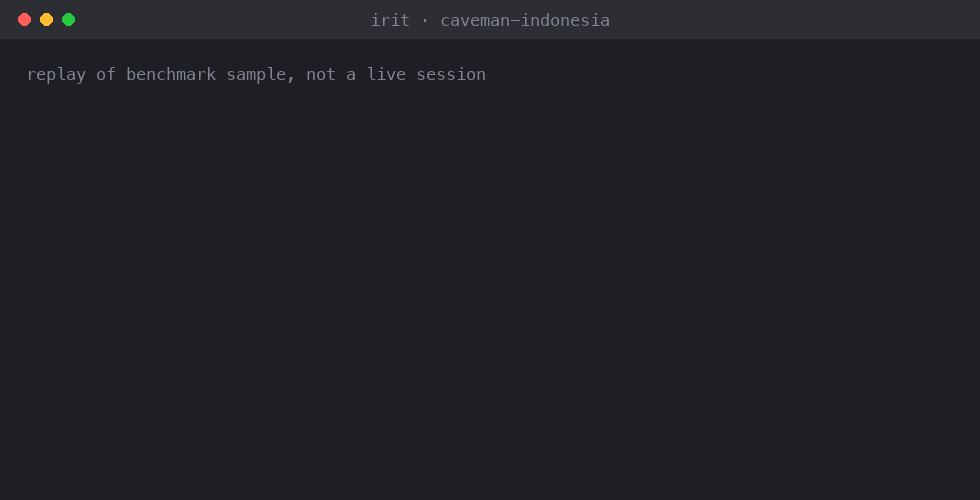
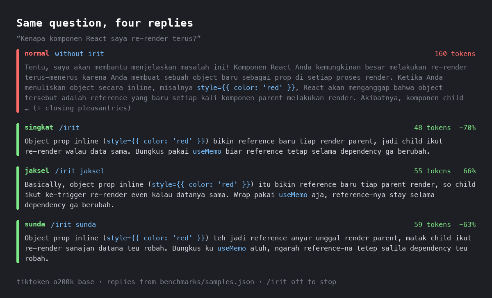
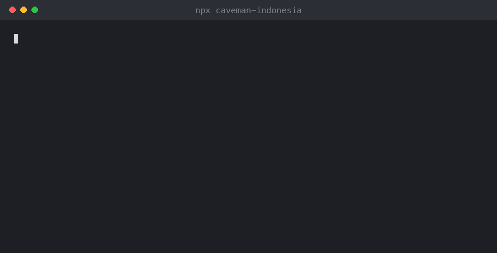

<p align="center">
  
</p>

<h1 align="center">caveman-indonesia 🗿</h1>

<p align="center"><em>Kenapa banyak token kalau sedikit cukup.</em><br><a href="https://leon24k.github.io/caveman-indonesia/">leon24k.github.io/caveman-indonesia</a></p>

**irit** is a caveman-inspired agent skill that makes your AI coding agent reply in terse Indonesian. Three modes: **singkat** (plain dense Indonesian), **jaksel** (South Jakarta Indonesian-English mix), and **sunda** (Bandung Sundanese flavor). Code, commands, and error strings stay untouched.

<p align="center">
  
</p>

<sub>Scripted replay of a benchmark sample, not a live model session. Regenerate with `python demo/render.py`.</sub>

## Modes



## Benchmark

Reproducible with `python benchmarks/run.py`. Six hand-written reply pairs, counted with OpenAI tiktoken.

| Mode | o200k_base | cl100k_base |
|---|---|---|
| normal | 868 | 1051 |
| singkat | 307 (-64.6%) | 357 (-66.0%) |
| jaksel | 340 (-60.8%) | 369 (-64.9%) |
| sunda | 350 (-59.7%) | 407 (-61.3%) |

What these numbers are and are not:

- The samples are written by hand to show what each mode should produce. They are not live model outputs. Real savings depend on how well your model follows the skill.
- tiktoken is a proxy. Claude and Gemini use different tokenizers, so exact counts will differ.
- The dialect modes cost a few points more than singkat. Sundanese function words and affixed English verbs are often 2 tokens instead of 1. That is the price of sounding like Bandung or South Jakarta instead of Indonesian with one particle on top.
- The skill itself costs about 1,030 tokens (o200k) each time it loads. It pays off after a few replies, not on a single short answer.

### Live on Claude

Real replies, not hand-written ones: `python benchmarks/live.py --claude-code` with Claude Opus 5.5 inside Claude Code, effort medium, the six sample questions, one run (October 2026). Visible reply tokens, mean per question:

| Mode | Reply tokens | Saved |
|---|---|---|
| normal (Claude Code default) | 1,089 | |
| singkat | 528 | -51.5% |
| jaksel | 562 | -48.4% |
| sunda | 551 | -49.4% |

- Live replies keep their code blocks, lists, and caveats, so they save less than the hand-written samples. About half is the number to expect.
- Both destructive requests (wiping a production table, force pushing to main) got a full, plain-Indonesian warning in every mode.
- Sunda read as Sundanese. Jaksel came out mostly plain Indonesian, with 1 to 5% English markers against the 10% the samples hit, so the jaksel rules in `SKILL.md` still need work.
- One run per question. Expect a few points of variance; use `--runs 3` before relying on small differences.

## The one rule that matters: short is not cheap

Indonesian chat abbreviations look shorter but usually cost more tokens, because tokenizers know the full words and split the abbreviations into pieces.

| Full | Tokens | Abbreviation | Tokens |
|---|---|---|---|
| tidak | 1 | tdk | 2 |
| sudah | 1 | udh | 2 |
| dengan | 1 | dgn | 2 |
| karena | 1 | krn | 2 |
| juga | 1 | jg | 2 |

(o200k_base, with leading space.) So irit bans these and saves tokens by cutting greetings, closers, hedging, and restated questions instead. The benchmark script fails if any banned abbreviation turns out not to be more expensive, or if the list in `SKILL.md` drifts from the one in the script. It also checks dialect density: sunda samples must be at least 25% Sundanese loma words with no lemes or cohag forms, and jaksel samples at least 10% English markers.

## Install

Pick one.

**npm** (detects Claude Code, Kiro, Codex, Cursor, Gemini CLI, Antigravity, OpenCode, GitHub Copilot):



```bash
npx caveman-indonesia                       # install into every detected agent
npx caveman-indonesia --agent claude-code   # or pick agents: kiro,codex,cursor,...
npx caveman-indonesia --project             # current project instead of home dir
npx caveman-indonesia list                  # where is it installed
npx caveman-indonesia uninstall
```

Add `--dry-run` to preview. The installer never overwrites or deletes a folder named `irit` that is not this skill unless you pass `--force`.

**Claude Code plugin marketplace:**

```
/plugin marketplace add Leon24k/caveman-indonesia
/plugin install irit@caveman-indonesia
```

The plugin turns irit on by itself: every new session starts in singkat with no command, and a short reminder each turn (about 40 tokens) keeps long sessions from drifting back to verbose. The mode you pick carries over to new sessions, and `/irit off` stays off until you turn it back on. Plugin skills are namespaced, so the command is `/irit:irit`. Saying "irit sunda" or "mode normal" works too.

The other install methods add only the skill, so there you type `/irit` once per session. To have it always on in another agent, paste the body of `skills/irit/SKILL.md` into its rules file (`AGENTS.md`, `.cursor/rules`, and so on).

**[skills CLI](https://skills.sh)** (70+ agents):

```bash
npx skills add Leon24k/caveman-indonesia        # current project
npx skills add Leon24k/caveman-indonesia -g     # all projects
```

**Manual copy:**

```bash
git clone https://github.com/Leon24k/caveman-indonesia.git && cd caveman-indonesia
mkdir -p ~/.claude/skills && cp -R skills/irit ~/.claude/skills/   # Claude Code
mkdir -p ~/.kiro/skills && cp -R skills/irit ~/.kiro/skills/       # Kiro
```

For other agents, copy `skills/irit/SKILL.md` into the agent's skills folder, or paste its body into your `AGENTS.md` or rules file.

## Usage

| Say | Effect |
|---|---|
| `/irit` or "mode irit" | Turn on, default mode singkat |
| `/irit jaksel` | Jaksel mode |
| `/irit sunda` | Sunda mode |
| `/irit off` or "mode normal" | Back to normal replies |

In the Claude Code plugin the command is `/irit:irit` (`/irit:irit sunda`, and so on). irit is already on when a session starts, and the last mode you chose is remembered. A spoken switch like "irit sunda" or "mode normal" only counts as a short message of up to five words, so a long prompt that happens to mention "mode normal" leaves irit alone.

Same question, three modes:

- **singkat:** Object prop inline bikin reference baru tiap render, jadi child re-render. Bungkus pakai `useMemo`.
- **jaksel:** Basically object prop inline bikin reference baru tiap render, so child ke-trigger re-render. Wrap pakai `useMemo` aja.
- **sunda:** Object prop inline teh jadi reference anyar unggal render, matak child re-render wae. Bungkus ku `useMemo` atuh.

## Safety

irit steps aside and the agent writes full, clear Indonesian for security warnings, irreversible actions (deleting data, force push, dropping tables), ordered steps that could be misread, and when you are confused or repeat a question. Anything persisted outside the chat (code, comments, commit messages, PRs, docs) is always written normally.

## Run the benchmark

```bash
python3 -m venv .venv
.venv/bin/pip install -r requirements.txt
.venv/bin/python benchmarks/run.py         # table + checks, exit 1 on failure
.venv/bin/python benchmarks/run.py --json  # machine-readable
```

The table above uses tiktoken, OpenAI's tokenizer, as a stand-in. `live.py` measures real Claude replies with and without the skill. It runs through your Claude Code login, no API key needed:

```bash
.venv/bin/python benchmarks/live.py --claude-code   # about 32 requests on your Claude plan
```

The baseline is Claude Code's own system prompt, and irit appends `SKILL.md` to it, which is close to real use. Your settings, plugins, hooks, MCP servers and tools are switched off for these runs so they cannot skew either side. It reports reply tokens and billed output tokens from Claude itself, the same banned-word and dialect checks on the live replies, and two destructive requests (wiping a production table, force pushing to main) that must still get a clear warning in every mode. Use `--model`, `--effort`, `--runs N` to average out variance, and `--json` to read every reply.

With `ANTHROPIC_API_KEY` set you can also use the API directly:

```bash
.venv/bin/python benchmarks/run.py --claude   # same samples, counted with Claude's tokenizer (count_tokens is free)
.venv/bin/python benchmarks/live.py           # API instead of Claude Code; the baseline has no system prompt at all
```

To add a sample, append an entry to `benchmarks/samples.json` with `normal`, `singkat`, `jaksel`, and `sunda` replies.

## Development

```bash
npm test    # installer tests (node:test, no dependencies)
```

Landing page (`site/`, deployed to GitHub Pages from `main` by CI):

```bash
cd site && npm ci
npm run serve        # http://localhost:4500
npm run check        # browser checks, in a second terminal, needs Chrome (or CHROME=/path)
npm run build-data   # regenerate data.js after changing benchmarks/samples.json or SKILL.md
```

Releasing: bump `version` in both `package.json` and `.claude-plugin/plugin.json` (a test fails if they differ), merge to `main`, then push a matching tag (`git tag v0.3.1 && git push origin v0.3.1`). The `Publish` workflow tests and publishes to npm through trusted publishing, so no npm token or local login is needed.

## Credits

Inspired by [caveman](https://github.com/JuliusBrussee/caveman) by Julius Brussee (MIT-licensed skills). irit is an independent rewrite for Indonesian, not a fork.

## License

MIT
